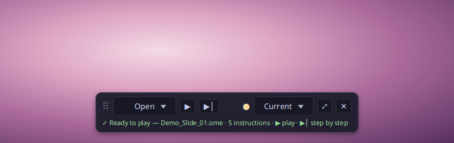
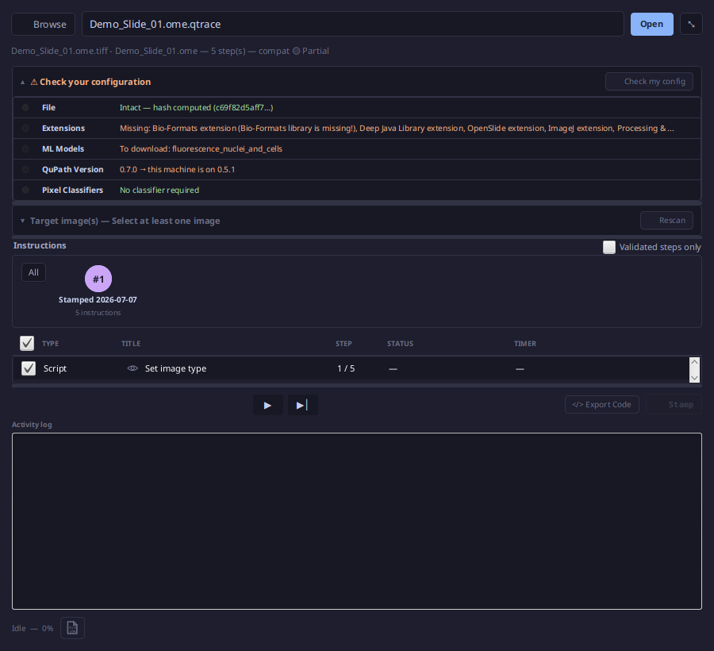

# qTrace Player

**Replay any recorded QuPath analysis, step by step, on the same image or on a whole project.**

The Player is the replay module of [qTrace](../README.md), the QuPath extension that records the
provenance of an image analysis. It opens a `.qtrace` record (or a qtrace.ca certificate) and
runs its instructions again in QuPath, one at a time or all at once, and writes a new trace of
the run.

- **License:** GNU GPL v3 or later, like qTrace Core
- **Version:** 0.1.0
- **Requires:** QuPath 0.5+ (tested on 0.7.x) and qTrace Core. No account is needed.

## Mini-player

A small floating bar over the image: open a record, play it, and follow each instruction on the
line under the buttons.



- **Open ▾**: a local `.qtrace` file, or a `qtc_…` ID or share link from qtrace.ca
- **▶ / ⏸**: play, pause, resume where it stopped; **▶|** runs a single instruction
- **●**: overall compatibility of the record with this machine (🟢 / 🟡 / 🔴), click for details
- **Current ▾**: the image open now, or every image of the project as a batch
- **⤢**: opens the full Player on the same record

## Full Player

The same replay with everything visible: the configuration check, the target images, the
sessions and their instructions, and the activity log.



- **Check your configuration**: file integrity (hash), missing QuPath extensions, ML models to
  download, QuPath version, pixel classifiers
- **Target image(s)**: pick the images of the project the replay applies to
- **Instructions**: one bubble per recorded session; tick or untick instructions, show only
  validated (stamped) steps
- **Export Code**: the Groovy script the replay runs, to read or keep
- **Activity log**: what ran, what failed and why. A failed instruction pauses the replay on that
  step

Each run writes a new `.qtrace` that points to the record it replayed. With qTrace Compliance
and a certified identity, the replay log carries that identity and can be signed; without them,
it records the operating-system user.

## Command line

The replay engine also runs without QuPath, to produce the Groovy script of a record:

```bash
cd qtrace-core && ./gradlew jar && ./gradlew -p player cliJar
java -jar player/build/libs/qtrace-replay-cli-0.1.0.jar ./analysis.qtrace --out replay.groovy
```

Options: `--session <n>` (one session, 0-based), `--validated-only` (stamped sessions only),
`--print` (to stdout), `--help`.

## Build

```bash
cd qtrace-core
./gradlew jar                 # the Core JAR the Player compiles against
./gradlew -p player test      # tests
./gradlew -p player qtjar     # signed module for the qTrace loader (needs the signing key)
```

The Player is normally installed for you: qTrace Core's "Getting started" window installs it,
and updates arrive at the next QuPath start.

## Source layout

```
src/main/java/io/qtrace/player/
  PlayerExtension.java        entry point: registers the Player with Core
  QTraceMiniPlayerBar.java    the mini-player; ⤢ opens the full Player
  QTraceReplayPlayer.java     the full Player window
  QTraceReplayEngine.java     loads a record or workflow, builds the steps, assembles the script
  QTracePreflightDialog.java  configuration check and the catalogue of known QuPath extensions
  ReplayExecutor, ReplayRecorder, ReplayLogWriter, ReplayStep   run, new trace, replay log
  RecordSource, RecordSessions, WorkflowSource                  what the Player opens
  QTraceReplayCLI.java        the command line
  ext/                        per-extension replay handlers (InstanSeg…)
```

## License

Copyright (C) 2026 Romain Tourte. This program is free software: you can redistribute it and/or
modify it under the terms of the GNU General Public License as published by the Free Software
Foundation, either version 3 of the License, or (at your option) any later version. See
[LICENSE](LICENSE).
