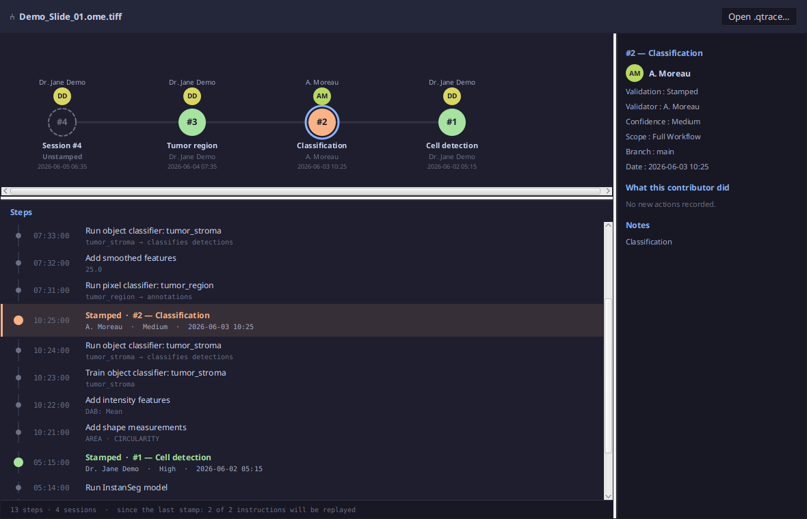

# qTrace Version Graph

**See every version of an image analysis: who did what, when, and what was validated.**

Version Graph is the **Version(s)** window of [qTrace](../README.md), the QuPath extension that
records the provenance of an image analysis. It reads a `.qtrace` record and draws its history like
a git graph: one circle per version (a session of work), from the latest on the left to the first
one on the right, and under it every instruction that was run.

- **License:** GNU GPL v3 or later, like qTrace Core
- **Version:** 0.1.0
- **Requires:** QuPath 0.5+ (tested on 0.7.x) and qTrace Core. No account is needed.



## What it shows

- **The graph** — one circle per version. A filled circle is a validated (stamped) version, coloured
  by its confidence; a dashed one was saved but not validated yet, like the work in progress. Above
  each circle, who did it; under it, its title, its validator and its date.
- **The steps** — every instruction, the latest first, each version closing on its stamp. Each row
  says what the instruction did in a few words (the model, the classifier, the channels…). Click a
  circle to list only that version's instructions; click beside the circles to list them all again.
- **The detail** — on the right, for the version or the instruction selected: validation, validator,
  confidence, scope, date, the image's hash, what the contributor did, the notes, and for an
  instruction its full script.
- **The footer** — how many steps and versions, and how many instructions a replay would run since
  the last stamp.

## Take an instruction out of the replay

On the image open in QuPath, each step that can be replayed has a **−** button: it takes the
instruction out of the replay (**+** puts it back). The record keeps it, marked as skipped, with who
skipped it and when. Once a version is validated, its instructions are frozen.

## Open a record or a workflow

**Open .qtrace…** reads any record, not only the one of the open image. The window also reads a
workflow (`.qtflow`): its packets are drawn in mauve, with what each holds and where it comes from.
It only reads: the record is never written, except for the − / + of the replay.

## For a module of your own

The window only reads, and keeps its extension points `protected` — `contentOf`, `decorateStepRow`,
`rowsFor`, `cellCreated`, `addStepDetailActions`… — so that another QuPath extension can build a
window of its own on it, with the same graph, list and detail pane.

## Build

```bash
cd qtrace-core
./gradlew jar                       # the Core JAR this module compiles against
./gradlew -p versiongraph test      # tests
./gradlew -p versiongraph qtjar     # signed module for the qTrace loader (needs the signing key)
```

The module is normally installed for you: qTrace Core's "Getting started" window installs it, and
updates arrive at the next QuPath start.

## Source layout

```
src/main/java/io/qtrace/versiongraph/
  VersionGraphExtension.java   entry point: registers the Version window with Core
  QTraceCommitGraph.java       the Version(s) window: graph, steps, detail, − / + of the replay
  VersionTimeline.java         a record's steps as readable rows (pure, no JavaFX)
```

## License

Copyright (C) 2026 Romain Tourte. This program is free software: you can redistribute it and/or
modify it under the terms of the GNU General Public License as published by the Free Software
Foundation, either version 3 of the License, or (at your option) any later version. See
[LICENSE](LICENSE).
